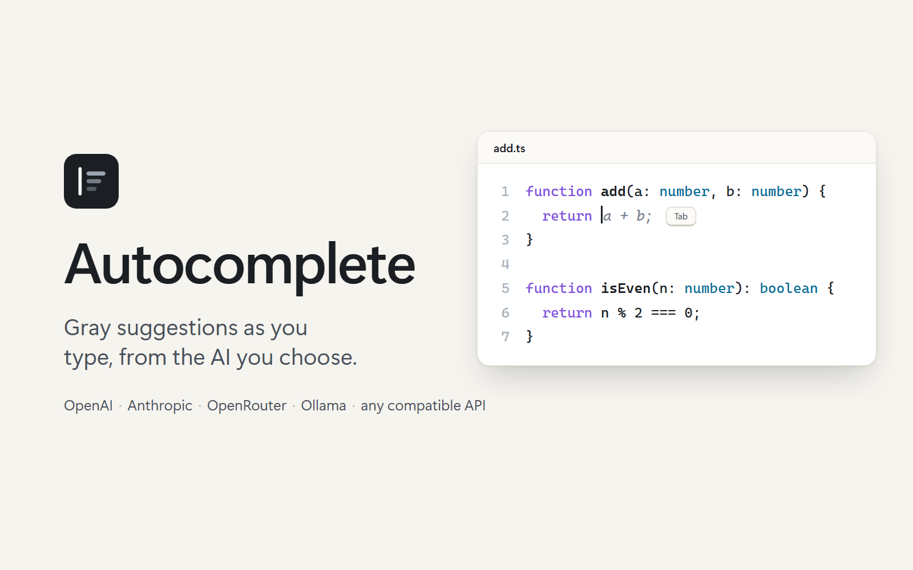
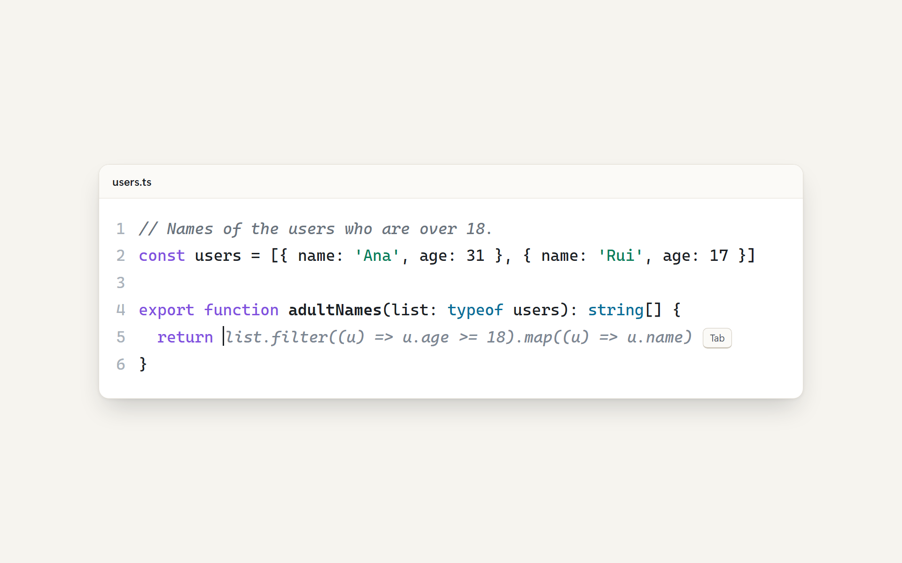
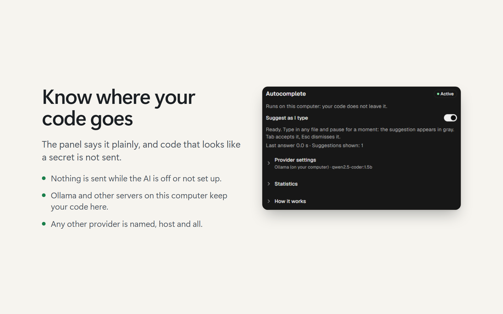

<p align="center"></p>

# Autocomplete for Orca

Gray suggestions as you type, from the AI provider you choose. Press **Tab** to accept one, **Esc** to dismiss it. And a code editor that is useful with the AI off: completion and errors from your language servers, snippets, postfix templates, and a rename carried over to the other uses of a name.

Works with **OpenAI**, **Anthropic**, **OpenRouter**, **Mistral / Codestral**, **Ollama** (free, on your computer) and any API that speaks the OpenAI or Anthropic format.

## Install

```sh
orca plugin install actus7/orca-autocomplete
```

Orca lists what the plugin asks for and prints a fingerprint. Accept it by running the same command again with `--approve <fingerprint>`. You can also install it from *Settings → Plugins*.

> **Requires Orca 1.4.248 or newer** (tested on 1.4.255). The plugin brings its own editor (Monaco), so it does not depend on any change to Orca itself.

<p align="center"></p>

## Quick start

It takes about two minutes.

1. **Open the Autocomplete panel**: the lightning icon in the right sidebar.
2. **Choose your provider**, paste your API key, then pick a model from the list your provider offers or type its name. Press **Save and test**. Ollama needs no key.
3. **Open a code file and pause while typing.** The suggestion appears in gray.

**Which files open in this editor.** Files in the languages listed below open in the plugin's editor by default. A few types are always opened by Orca's own editor first: `.ts`, `.md`, `.yaml`, `.json`, `.env` and some more. For those, switch with the view toggle at the top right of the file's tab. Orca does not remember that choice, so you switch again for the next file.

## The editor

A full code editor (Monaco, the engine behind VS Code) that follows Orca's theme and stays in step with the file: saving, unsaved-change and outside-change handling are Orca's own.

- **Looks like Orca's editor:** it sits in the same tab, so the path bar, the view toggle, saving and the outside-change banner are Orca's own. Inside, it uses the same options and the same stock dark or light theme as Orca's editor (line numbers, no minimap, wrapped lines, 2-space tabs, no caret animation), and it follows the app when you switch between dark and light.
- **Follows your Orca settings:** font and size (editor zoom included), weight, line height, ligatures, line wrapping and the minimap come from Orca itself (`editor.readTypography`), so the plugin's editor and Orca's, side by side, look the same, and a change you make in Orca (*Settings → General*, the editor zoom, or the file menu's *Line wrap*) shows up in the plugin's editor right away. The minimap is off until you turn it on in Orca, then it is on in both. If you turn off *Match Orca's editor*, the four editor settings of this plugin apply instead.
- **Languages with their own editor:** TypeScript, JavaScript, Python, Go, Rust, Java, Kotlin, C#, C and C++, PHP, Ruby, Swift, Shell, SQL, HTML. A **Code** editor handles CSS, SCSS, Less, XML, YAML, Markdown, Dart, Lua, R, PowerShell, Batch, Scala, Elixir, Clojure, Perl, F#, Julia, Terraform, Protocol Buffers, GraphQL, Dockerfile and LaTeX (`.tex`, `.sty`), recognising the language from the file's content.
- **Documents:** Markdown and text files (`.md`, `.txt`) get suggestions written as prose, in the language of the text around the cursor: the rest of the sentence, or one more short sentence, never a block of code.
- **Built in, nothing to install:** errors, completion, hover, go to definition and rename for TypeScript and JavaScript, HTML and CSS, within the open file.
- **Language servers:** if a language server is installed on your computer (`rust-analyzer`, `gopls`, `pyright`, `clangd`, `typescript-language-server`, `kotlin-language-server`, `csharp-ls`, `intelephense`, `solargraph`, `sourcekit-lsp`, `bash-language-server`, `lua-language-server`, `yaml-language-server`, `texlab`, Dart's), the plugin starts it for files inside an Orca workspace and adds its errors, completion (picking a symbol from another file inserts its import), hover, signature help, definitions, references, outline, formatting, rename and quick fixes. Turn it off in *Settings → Plugins → Autocomplete → Use language servers*. If the server cannot start, a red note in the editor's corner says why.
- **Snippets, no AI needed:** short words that expand into the shape of common code, for TypeScript, JavaScript, Python, Go, Rust, Java, C#, C and C++, PHP, Ruby, Shell and SQL. Press **Ctrl+Space** after the word (`forof`, `iferr`, `def`, `match`, `sel` ...) and pick it from the list; fill the stops with **Tab**. The list does not pop up by itself while you type, so it never competes with the gray suggestion.
- **Postfix templates, no AI needed:** write an expression, type a dot and pick a template, and the expression is wrapped for you. In TypeScript and JavaScript `ready.if` becomes `if (ready) { … }`; `.else`, `.null`, `.not`, `.var`, `.return`, `.log`, `.for` and `.await` work the same way. They exist for TypeScript, JavaScript, Python, Go, Rust, Java and C#. The template takes the name, member chain, call or index right before the dot; for a bigger expression wrap it in parentheses first (`(a && b).if`). Nothing is offered inside a string or a comment.
- **The next edit, no AI needed: a rename carried over.** Change a name in one place (three letters or more) and pause: the other uses of the old name in the file are offered one at a time. The text to replace is struck through and the new name sits beside it. **Tab** applies it and offers the next one; **Esc**, or typing anything, dismisses it; **Ctrl+Z** takes back one applied edit. It is always on and sends nothing anywhere. An undo, a reload of the file and a whole new text are never read as an edit of yours.
- **The next edit, with AI (off by default).** Turn on *Predict the next edit with AI* in *Settings → Plugins → Autocomplete*. After you change a line and pause, the lines around the change and what you changed go to your provider, which may name one other line that needs the same change. Its answer is only used when it repeats that line word for word, and it is shown like the rename above for you to accept. It costs one extra request per pause, never more often than every 1.5 seconds, and works with OpenAI- and Anthropic-compatible providers (not Ollama or Mistral fill-in-the-middle). Markdown and text files are skipped.
- **Limits:** a language server needs the file to be inside a local Orca workspace (remote hosts are not reached). Definitions and renames that touch other files are not followed yet. TypeScript needs the project's own `typescript` package in `node_modules`.

If something is not right, the panel says what happened and what to do next.

| Keys | What it does |
| --- | --- |
| **Tab** | Accept the whole gray suggestion; with none showing, apply the proposed next edit (struck through and green); otherwise indent as usual. |
| **Ctrl+→** | Accept the next word of the gray suggestion. |
| **Ctrl+Alt+→** | Accept the next line of it. |
| **Esc** | Dismiss the gray suggestion, or else the proposed next edit. |
| **Ctrl+Space** | Open the suggestion list (symbols, snippets). The dot opens it by itself for members and postfix templates. |

### What is not here yet

The next edit covers one line of the open file, or the other uses of a renamed name; edits that follow a change into **other files**, project-wide context for the AI, completion from JSON Schema or a database schema, a `switch` generated from a type, and building an expression from the type a spot needs are not in this version. The next edit is drawn by the plugin itself rather than with Monaco's inline-edit API, which is experimental in the version bundled here, shows a single edit and was folded into the standard API later. Project context was tried with a code graph and showed no measurable gain with the provider available (see Benchmark below).

<p align="center"></p>

## Choose a provider

| Provider | API key | Notes |
| --- | --- | --- |
| OpenAI | Yes | Pick a small, fast model. |
| Anthropic (Claude) | Yes | A Haiku-class model is a good fit. |
| OpenRouter | Yes | One key, many models. |
| Ollama | No | Runs on your computer: free and private. Uses Ollama's own API, which fills in the middle of code, so pick a code model such as `qwen2.5-coder`. Start Ollama first. |
| Mistral / Codestral | Yes | `codestral-latest` is made to fill in code between the text before and after the cursor. |
| Other, OpenAI-compatible | Optional | Any gateway or proxy with a `/chat/completions` endpoint. |
| Other, Anthropic-compatible | Optional | Any endpoint with a `/v1/messages` endpoint. |

**Pick the model from the list, or type its name.** A short list (up to 15 models) is just a picker, with a small link for a model it does not show. A long list gets a search box and a second tab to type the name. If the list cannot be loaded, you get a plain text field. Models are listed with how fast they are: a time followed by a × (for example `0.6s (14×)`) is the median of your own real suggestions, which is the most honest number. Where it makes sense (Ollama, OpenRouter and other long lists, not OpenAI or Anthropic) **Test speed** times up to 12 models with one short request each, your current model first. A star marks the fastest, a cross marks models that failed or answered something unusable, and **Use the fastest** selects the best.

**Two ways to ask.** Chat providers (OpenAI, Anthropic, OpenRouter, the *Other* options) are told to answer with only the code to insert. Ollama and Mistral are given the text before and the text after the cursor as separate fields and fill the gap themselves, which is what they are trained for.

**Speed matters more than size.** A suggestion that takes longer than 1.8 seconds arrives after you have moved on, so the plugin drops it. Choose a small, fast model. The panel pre-fills a sensible one for each provider.

## The status bar

The lightning icon at the bottom of Orca shows the state at a glance. Click it to turn Autocomplete on or off.

| Color | Meaning |
| --- | --- |
| Green | Active. Shows how long the last answer took. |
| Gray | Off. |
| Yellow, "set up" | Finish the setup in the panel. |
| Yellow, "slow" | The provider answers too slowly; try a faster model. |
| Red | The last request failed. Hover for the reason and what to do. |

The command palette also has **Autocomplete: Turn on or off** and **Autocomplete: Test connection**.

## Statistics

The panel has a **Statistics** block for the model you use: how many suggestions were shown, how many you accepted (whole, or a word or line at a time), how many were still there after 30 seconds, how many were removed or changed soon after, how many arrived too late to show, and how long answers take (the median, and the time within which 95% answered). A model that is accepted often *and* kept is a good fit; one that is accepted and then deleted is not. The numbers live on your computer only and **Clear statistics** starts them again.

## Privacy

When you pause typing, the text around your cursor (up to about 6,000 characters before it and 2,000 after, plus the kind of file) is sent to the provider **you** chose, and nowhere else. If that text holds something that looks like a key, a token, a private key or a password in a web address, **nothing is sent** and there is no suggestion at that spot. Your API key is stored encrypted by Orca and is tied to the provider it was saved for: if you switch providers, the panel asks for a new key, and the old one is never sent to the new one. Language servers run on your computer and nothing from them is sent anywhere. The panel always says where that text goes: nowhere (the AI is off or not set up), this computer (Ollama or another server on localhost), or the host of the provider you chose. A server elsewhere on your network counts as remote. If you turn on the AI next edit, the lines around a change and what you changed (a few lines, with the same check for secrets) go to the same provider, and only when you pause after an edit. The rename carried over sends nothing. The statistics are counted and kept on your computer only. The plugin has no telemetry and no analytics. Turn it off any time from the panel or the status bar.

## Troubleshooting

| What you see | What to do |
| --- | --- |
| Nothing appears | Pause for a moment after typing. Check that the status bar icon is green. Not every spot gets a suggestion. |
| No suggestions in a `.ts`, `.md`, `.yaml` or `.json` file | Orca opened it in its own editor. Use the view toggle at the top right of the file's tab. |
| No suggestion near a key, token or password | By design: nothing is sent while such text is around the cursor. |
| "The provider rejected the key" | Paste the key again in the panel and press **Save and test**. Check that it belongs to the provider you picked. |
| "Model or address not found" | Check the model name and, for the *Other* providers, the base URL. |
| "Could not reach … Is the server running?" | For Ollama, start it. Otherwise check the address and your connection. |
| "The server refused the request" (Ollama) | The model cannot fill in the middle of code. Pick a code model such as `qwen2.5-coder`, or use *Other (OpenAI-compatible)*. |
| Yellow "slow" | Pick a smaller model, or one hosted closer to you. |
| "Rate limit reached" | Wait a moment, or pick another model. |
| Tab indents instead of applying the proposed edit | A gray suggestion or the suggestion list was open and took the key, or the proposal went away because you typed. Press Tab again after it is back. |
| The AI never proposes a next edit | *Predict the next edit with AI* is off by default, and it needs an OpenAI- or Anthropic-compatible provider. It only proposes a line that needs the same change as the one you made. |
| Gray text that is not code (notes, odd tags) | Your gateway adds instructions of its own to every request. The plugin drops tool-call markup, but a route without injected prompts gives better suggestions. |

## Português (pt-BR)

O painel, a barra de status e os avisos aparecem em português quando o Orca está em pt-BR.

**Instalação**

```sh
orca plugin install actus7/orca-autocomplete
```

O Orca mostra o que o plugin pede e um *fingerprint*. Para aceitar, rode o mesmo comando de novo com `--approve <fingerprint>`. Também dá para instalar em *Settings → Plugins*. Requer o Orca 1.4.248 ou mais novo.

**Começo rápido**
1. Abra o painel **Autocomplete** (o raio na barra lateral direita).
2. Escolha o provedor, cole a chave de API, depois escolha um modelo na lista do seu provedor ou digite o nome. Toque em **Salvar e testar**. O Ollama não precisa de chave.
3. Digite em um arquivo de código e faça uma pausa. A sugestão aparece em cinza; **Tab** aceita e **Esc** descarta.

**Quais arquivos abrem neste editor.** Os arquivos das linguagens listadas acima abrem no editor do plugin por padrão. Alguns tipos são sempre abertos antes pelo editor do próprio Orca: `.ts`, `.md`, `.yaml`, `.json`, `.env` e alguns outros. Neles, troque pelo seletor de visualização no canto superior direito da aba do arquivo. O Orca não lembra a escolha, então a troca vale para um arquivo por vez.

**Sem IA.** O editor também funciona com a IA desligada: erros, completar e importar automático dos seus servidores de linguagem, **snippets** e **modelos postfix**. Os snippets (`forof`, `iferr`, `def`, `match`, `sel` ...) abrem com **Ctrl+Espaço** depois da palavra; não aparecem sozinhos enquanto você digita, para não competir com a sugestão cinza. No postfix, escreva uma expressão, digite um ponto e escolha o modelo: em TypeScript, `pronto.if` vira `if (pronto) { … }` (também `.else`, `.null`, `.not`, `.var`, `.return`, `.log`, `.for`, `.await`). Para uma expressão maior, ponha entre parênteses: `(a && b).if`. Nada aparece dentro de texto entre aspas ou de comentário.

**Próxima edição, sem IA: renomeação levada adiante.** Troque um nome em um ponto (com três letras ou mais) e faça uma pausa: os outros usos do nome antigo no arquivo são oferecidos um de cada vez. O texto a trocar aparece riscado e o novo, ao lado. **Tab** aplica e já oferece o próximo; **Esc**, ou digitar qualquer coisa, dispensa; **Ctrl+Z** desfaz uma edição aplicada. Fica sempre ligado e não envia nada a lugar nenhum. Desfazer, recarregar o arquivo e trocar o texto inteiro nunca contam como uma edição sua.

**Próxima edição, com IA (desligada por padrão).** Ligue *Predict the next edit with AI* em *Settings → Plugins → Autocomplete*. Depois que você muda uma linha e faz uma pausa, as linhas ao redor e o que você mudou vão ao seu provedor, que pode apontar **uma** outra linha que precisa da mesma mudança. A resposta só vale se repetir essa linha palavra por palavra, e aparece como a renomeação acima, para você aceitar. Custa um pedido a mais por pausa, no máximo um a cada 1,5 s, e funciona com provedores compatíveis com OpenAI e Anthropic (não com Ollama nem com o preenchimento da Mistral). Arquivos Markdown e de texto ficam de fora.

**Teclas.** **Tab** aceita a sugestão cinza inteira; sem sugestão cinza, aplica a próxima edição proposta (riscada e verde); fora isso, indenta como sempre. **Ctrl+→** aceita a próxima palavra, **Ctrl+Alt+→** a próxima linha, e **Esc** descarta a sugestão cinza ou, se não houver, a edição proposta.

**Ainda não existe.** Acompanhar uma mudança em **outros arquivos**, contexto do projeto inteiro para a IA, completar a partir de JSON Schema ou de esquema de banco, gerar um `switch` a partir de um tipo e montar uma expressão a partir do tipo que o ponto pede não entram nesta versão. A próxima edição é desenhada pelo próprio plugin, e não pela API de edição em linha do Monaco, que nesta versão é experimental, mostra uma edição só e foi incorporada à API padrão depois.

**Provedores.** OpenAI, Anthropic, OpenRouter, Mistral / Codestral, Ollama e qualquer API compatível com OpenAI ou Anthropic. O Ollama e a Mistral recebem o texto antes e o texto depois do cursor e preenchem o trecho do meio; os demais respondem como chat. Use um modelo pequeno e rápido: uma sugestão que passa de 1,8 s é descartada.

**Estatísticas.** O painel mostra, para o modelo em uso, quantas sugestões foram mostradas, aceitas (inteiras ou por palavra), mantidas após 30 s, removidas depois, tardias, e o tempo de resposta. Tudo fica só no seu computador, e **Limpar estatísticas** zera.

**Privacidade:** o texto ao redor do cursor vai apenas para o provedor que você escolheu, e nada é enviado se ele parecer conter uma chave, um token ou uma senha. O painel sempre diz para onde o texto vai: nenhum lugar (IA desligada ou não configurada), este computador (Ollama ou outro servidor no localhost) ou o host do provedor. A chave fica guardada criptografada pelo Orca e só vale para o provedor em que foi salva. Não há rastreamento.

**Problemas comuns**
- *Nada aparece em um arquivo `.ts`, `.md`, `.yaml` ou `.json`:* ele abriu no editor do Orca; use o seletor de visualização.
- *"O servidor recusou o pedido" (Ollama):* o modelo não completa no meio do código; escolha um modelo de código, como o `qwen2.5-coder`, ou use *Outro (compatível com OpenAI)*.
- *Texto cinza que não é código:* o seu roteador injeta instruções próprias em cada pedido. O plugin descarta marcação de chamada de ferramenta, mas uma rota sem prompts injetados dá sugestões melhores.

## For developers

```sh
npm install
npm test            # worker, language server bridge, editor logic (Node 22.18+)
npm run typecheck   # types for the worker, the panel and the editor
npm run test:panel  # the panel, drawn by Orca's own runtime (needs the `orca` command line; it runs the Node tests again too)
npm run test:browser # the editor code, and then the built bundle, in a real Chrome/Chromium/Edge (about 40 s; skips itself if there is none)
npm run build       # bundles Monaco and the editor into editor/dist (commit the result)
npm run bench -- --base-url http://localhost:11434/v1 --model qwen2.5-coder:1.5b --yes   # see bench/run.mjs
```

Orca installs a plugin as plain files, so `editor/dist` is committed; its source is `editor/src`. `editor/languages.mjs` is the one table that drives the pages, the loaders and the `customEditors` of the manifest, and a test keeps them in line with Orca's limits (16 editors, 32 extensions each).

### Permissions

The plugin asks Orca for: its own settings, secrets and storage; and `workspace:read`, only to learn the folders of your local workspaces so a language server can be started in the right one. It does not ask to open files, run commands or change workspaces.

To match Orca's editor, the worker asks Orca for the typography its file editor uses (`editor.readTypography`, which needs no permission) and listens for `editor.typography.changed`. It reads none of Orca's files.

### Images

`assets/build.mjs` draws the icon and the cover, and places the two real captures in `assets/captures` (the editor with a suggestion showing, and the panel) on the 1920x1200 screens of the listing (the catalog asks for at least 1280x800). It needs Playwright; see the header of that file.

### Benchmark

`bench/` measures a provider and model on this repository's own code (cuts a line inside code, asks for the rest, compares with what was there), so a change can be judged by numbers. It sends pieces of the files to the provider you name; a remote one needs `--yes`. `node bench/compare.mjs a.json b.json` compares two runs made with the same `--seed` and `--samples` place by place and says whether a difference is more than chance. `--context graph` adds an experiment: the declarations from other files that the code nearby uses, read from a [CodeGraph](https://github.com/colbymchenry/codegraph) index (`codegraph init` first; the `.codegraph/` folder is not committed).

### Releasing

1. Set the version in `orca-plugin.json`, then `npm run build`, `npm test`, `npm run test:browser` and `orca plugin validate .`.
2. Commit, then tag the commit `vX.Y.Z` and push the tag. The tag is what the catalog lists, and a listed version is permanent, so tag only a commit you have tried in Orca.
3. Give the repository the `orca-plugin` topic. The catalog finds public repositories by that topic and lists each version from its tag; there is no pull request to open.

MIT licensed.
